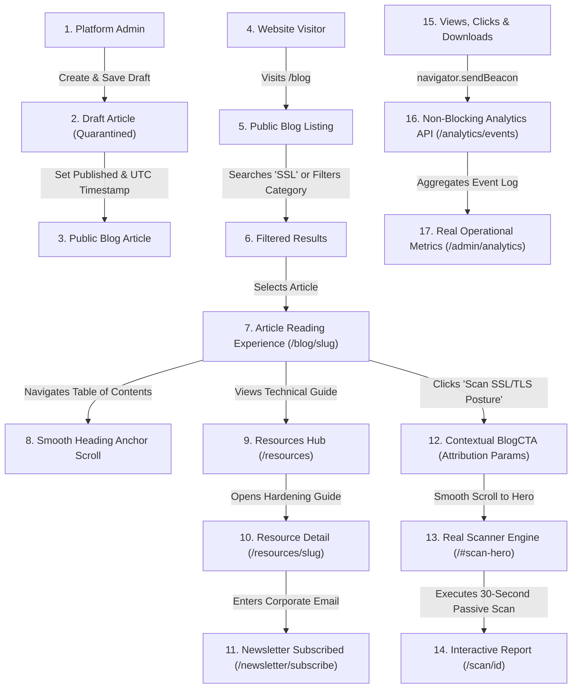

# SiteSecura Blog System — Final Verified End-to-End User Journey Walkthrough

This document records the verified user journey and operational routes across the complete SiteSecura Blog and Content Conversion Ecosystem (Phases E1–E7).

---

## 1. Verified Architecture & Route Map

| Stage | Route | Component / Handler | Primary Verification |
|---|---|---|---|
| **Admin Login & Auth** | `/login` → `/admin` | `AdminLayout.tsx` | Platform admin role required (`require_admin`); unauthenticated users receive 401; non-admin users receive 403. |
| **Admin Blog CMS** | `/admin/blog` | `AdminBlogManager.tsx` | Full editorial control: article creation, category selection, tag assignment, author profile, and media asset selection. |
| **Draft Protection** | `/api/v1/blog/posts/{slug}` | `apps/api/app/api/v1/cms.py` | Draft articles strictly quarantined; returns HTTP 404 on direct API and `/blog/{draft-slug}` with zero data leakage. |
| **Article Publishing** | `PATCH /api/v1/admin/blog/posts/{id}` | `publish_admin_blog_post` | Status transitions from `draft` to `published`; sets `published_at` timestamp; triggers audit log `BLOG_POST_PUBLISHED`. |
| **Public Blog Discovery** | `/blog` | `apps/web/src/app/blog/page.tsx` | High-contrast editorial homepage displaying `BlogHero`, `FeaturedArticle`, responsive `BlogGrid`, and category/tag filter pills. |
| **Real-time Search** | `/blog?q=ssl` | `BlogSearch.tsx` | Deterministic relevance ranking (+3 title, +2 excerpt, +1 content); clamped query; excludes drafts. |
| **Editorial Reading** | `/blog/[slug]` | `apps/web/src/app/blog/[slug]/page.tsx` | 2-column layout; safe markdown rendering; Table of Contents with smooth anchor scroll; reading time; breadcrumbs. |
| **Related Publications** | `/blog/[slug]` (bottom) | `RelatedArticles.tsx` | Dynamic scoring (+3 category, +2 tag, +1 author); excludes current post, drafts, and scheduled articles. |
| **Resources Hub** | `/resources` | `apps/web/src/app/resources/page.tsx` | Curated technical library with type tabs (Guides, Checklists, Tools, Templates), search, and free interactive utilities. |
| **Resource Detail** | `/resources/[slug]` | `apps/web/src/app/resources/[slug]/page.tsx` | Dedicated detail route with safe markdown rendering, direct asset download, external docs link, and TechArticle JSON-LD. |
| **Newsletter Dispatch** | `/blog`, `/resources` | `NewsletterSignup.tsx` | Reusable subscription component; rate-limited (5 req/5 min); duplicate idempotency; self-service unsubscribe. |
| **Defensive Scanner CTA** | Inline / Footer Callout | `BlogCTA.tsx` | 5 contextual variants (`general`, `ssl`, `headers`, `email`, `compliance`); routes directly to `/#scan-hero` with UTM attribution. |
| **Real Scanner Execution** | `/#scan-hero` → `/scan/[id]` | `LandingPage.tsx` → `ScanResultPage.tsx` | Independent deterministic passive scanning engine evaluating SSL/TLS, HTTP headers, DNS records, and cookies. |
| **Content Engagement Telemetry**| `/api/v1/analytics/events` | `apps/web/src/lib/analytics.ts` | Non-blocking telemetry tracking `blog_article_view`, `blog_cta_click`, `resource_view`, `resource_download`, `newsletter_signup`. |
| **Admin Content Metrics** | `/admin/analytics` | `get_admin_content_analytics` | Real aggregated database counts over 1–90 day windows; zero synthetic metrics or hardcoded rates. |
| **Search Engine Feeds** | `/sitemap.xml`, `/blog/rss.xml`, `/robots.txt` | Next.js Route Handlers | Dynamic XML sitemap combining published articles and resources; standard RSS 2.0 XML feed; crawl directives. |

---

## 2. Step-by-Step Verified User Journey

---

## 3. SEO & Feed Verification

- **Robots.txt (`/robots.txt`)**:
  - `Allow: /`
  - `Disallow: /dashboard/, /admin/, /api/, /scan/`
  - `Sitemap: https://sitesecura.com/sitemap.xml`
- **Dynamic Sitemap (`/sitemap.xml`)**:
  - Automatically indexes published blog articles with image URLs.
  - Automatically indexes published technical resources.
  - Excludes drafts, future-dated articles, deleted articles, and redirect origins.
- **RSS 2.0 Feed (`/blog/rss.xml`)**:
  - Compliant RSS 2.0 XML structure with `<channel>`, `<atom:link>`, `<lastBuildDate>`, and `<item>` entries.
  - XML characters (`<`, `>`, `&`, `'`, `"`) safely escaped.
  - Includes article title, URL permalink, RFC-822 publication date, excerpt, category, and author.
  - 1-hour cache header (`public, max-age=3600, s-maxage=3600`).
- **Structured Data (JSON-LD)**:
  - `BlogPosting`: Embedded in every published article with author, dates, and publisher.
  - `BreadcrumbList`: Embedded for breadcrumb navigation hierarchy.
  - `FAQPage`: Embedded when article contains FAQs.
  - `TechArticle`: Embedded in technical resource detail pages.
  - `CollectionPage`: Embedded on the `/resources` hub.

---

## 4. Security & Isolation Summary

- **Zero Draft Leakage**: Verified via direct HTTP GET requests; drafts return uniform 404 with no metadata or excerpt disclosure.
- **XSS Neutralization**: Tested with `<script>`, ``, and `javascript:` URLs; all dangerous schemes are neutralized.
- **Media Protection**: Uploads restricted to JPEG, PNG, WebP, GIF with magic-byte inspection; directory traversal attacks (`../../`) strictly neutralized.
- **Scanner Integrity**: The blog links directly to the production scanner (`/#scan-hero`) with zero mock or synthetic results; scanner modules and SSRF protections remain completely untouched and verified with 92 passing tests.
