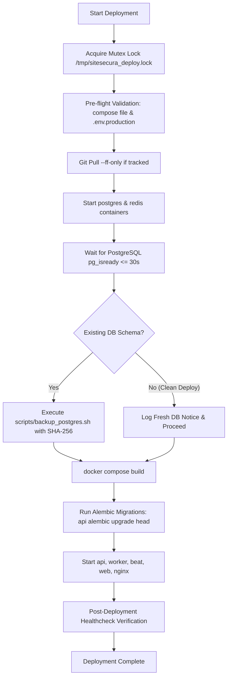

# SITESECURA — PHASE 7.1 DEPLOYMENT AND RECOVERY REVIEW

**Date:** October 2026  
**Auditor:** Principal DevSecOps & Incident-Response Engineer  
**Scope:** Deployment Automation, Database Backups, Disaster Recovery Drills, and Rollback Procedures  
**Verification State:** **CODE & SCRIPT LEVEL VALIDATED; LIVE VPS EXECUTION DEFERRED**

---

## 1. DEPLOYMENT AUTOMATION REVIEW (`scripts/deploy.sh`)

### 1.1 Architecture & Workflow
The production deployment script coordinates zero-data-loss upgrades across the entire SiteSecura Docker stack.

### 1.2 Key Hardening Improvements Made in Phase 7.1
1. **Startup Race Elimination:** Previously, Step 4 attempted to dump PostgreSQL before the database container was started. The script now starts `postgres` and `redis`, polls `pg_isready` until healthy, and only then proceeds.
2. **Conditional Backup Logic:** On initial server provisioning, running a backup on an empty, non-existent database failed the entire deployment. The script now inspects `information_schema.tables`. If tables are present, it performs a mandatory pre-migration backup; otherwise, it logs a clean deployment notice.
3. **Migration Environment Reliability:** Alembic migrations are executed against a running, healthy PostgreSQL instance via `docker compose run --rm --no-deps api alembic upgrade head`, guaranteeing that database locks and schemas apply cleanly before API workers start.
4. **Environment File Interpolation:** `docker-compose.prod.yml` now utilizes `${ENV_FILE:-.env.production}`, allowing testing and alternative environment files without hardcoded file-path dependency.

---

## 2. BACKUP INTEGRITY & CHECKSUMMING (`scripts/backup_postgres.sh`)

### 2.1 Backup Process
- Uses `docker exec` streaming `pg_dump` with `--clean --if-exists --no-owner --no-privileges` piped directly into `gzip -9`.
- Password is passed strictly via container environment `PGPASSWORD` to prevent leakage in process tables (`ps aux`) or shell history.
- Verifies that the resulting `.sql.gz` archive is greater than 500 bytes to detect silent dump failures.
- Restricts archive permissions to `chmod 600` and directory permissions to `chmod 700`.

### 2.2 Phase 7.1 Enhancements
- **Cryptographic Checksumming:** Immediately upon successful compression, generates an authoritative SHA-256 checksum file (`sitesecura_db_<TIMESTAMP>.sql.gz.sha256`) with `chmod 600`.
- **Retention Pruning Synchronization:** Prunes both `.sql.gz` dumps and their matching `.sha256` checksum files older than `RETENTION_DAYS` (default: 7 days) via `find` expressions.

---

## 3. DISASTER RECOVERY DRILL (`scripts/test_restore.sh`)

### 3.1 Restore Drill Architecture
- Completely isolated from production data: restores the latest available backup into an ephemeral, temporary container (`sitesecura-restore-drill-<TIMESTAMP>`) running on an isolated test database (`scanly_restore_test`).
- An exit trap guarantees that the ephemeral container is removed upon drill completion or failure.
- Verifies schema completeness by asserting table counts (`>= 5`) and testing table existence for critical entities: `users`, `organizations`, `scans`, `scan_checks`, `reports`.
- Records row counts for auditing.

### 3.2 Phase 7.1 Enhancements
- **Pre-Restoration Checksum Validation:** Before creating the test container, runs `sha256sum -c` against the archive's `.sha256` companion file. If the archive has been corrupted or modified, the drill aborts immediately with a critical alert.
- **RTO Duration Measurement:** Records start and end timestamps and outputs total restore execution duration in seconds, providing verifiable Recovery Time Objective (RTO) metrics.

---

## 4. ROLLBACK & RECOVERY PROCEDURE (`scripts/rollback.sh`)

### 4.1 Rollback Workflow
- Accepts a target Git reference (default: `HEAD~1`).
- Supports both interactive prompt and non-interactive automation via `-y` / `--yes` flag.
- Checks out the reference, rebuilds container images, restarts services with `--remove-orphans`, and triggers `scripts/healthcheck.sh`.

### 4.2 Database Migration Caveat & Operational Safety
- **CRITICAL RECOVERY RULE:** Reverting application code and containers does **NOT** automatically revert database schema changes.
- If a deployment applied backward-incompatible schema migrations (e.g., column drop, rename, or type change), running `alembic downgrade` is dangerous. The correct and tested recovery procedure is to restore the pre-deployment database backup created by Step 5 of `deploy.sh`.
- `scripts/rollback.sh` now prints this explicit warning on every invocation.

---

## 5. HOST-LEVEL DEPLOYMENT BOUNDARIES (WHAT REMAINS BLOCKED)

| Deployment Capability | Code / Script State | Live Host Verification Status | Blocker Description |
| :--- | :---: | :---: | :--- |
| Docker Compose Architecture | **READY** | **BLOCKED** | Requires physical/cloud Linux VPS with Docker engine |
| Deployment Script (`deploy.sh`) | **READY** | **BLOCKED** | Cannot run live bash deployment on local Windows development host |
| Automated Database Backups | **READY** | **BLOCKED** | Requires running production PostgreSQL container on VPS |
| Restore Test Drill (`test_restore.sh`) | **READY** | **BLOCKED** | Requires cron schedule and Docker daemon on production host |
| Remote Backup Off-Site Sync | **READY** | **BLOCKED** | Requires AWS S3 / Cloudflare R2 / Backblaze B2 credentials |
| Edge TLS & Cloudflare Proxy | **READY** | **BLOCKED** | Requires live DNS record pointing to VPS public IP |
